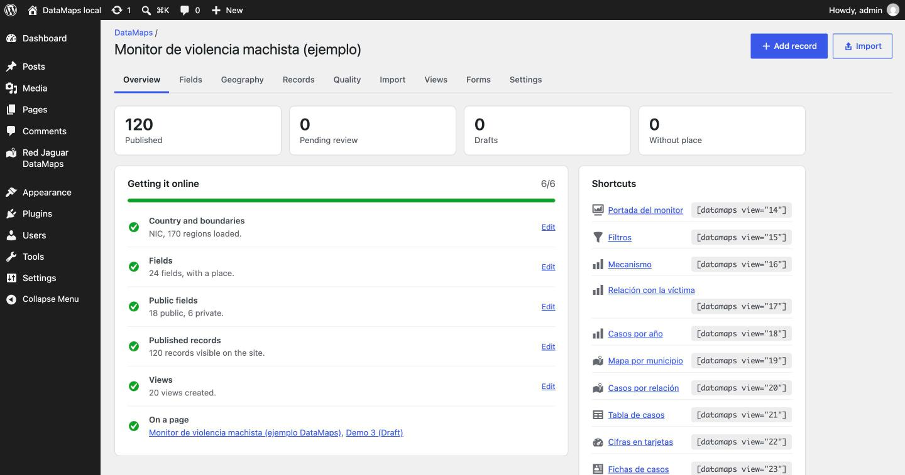

A dataset is one monitor: its fields, its records, its views and its forms. A site can have several.

## Create a dataset

Go to **Red Jaguar DataMaps → Datasets** and fill in **New dataset**:

- **Name** and **Country.** Each dataset covers one country.
- **Each record is a:** the word for each record, singular and plural, as the site shows it ("28 cases"). You can change it later.
- **Start with:**
  - **An empty dataset.** You add the fields, or import a spreadsheet to create them.
  - **A template**, ready to use:

    | Monitors | Other uses |
    |---|---|
    | Femicide monitor | Fan clubs |
    | Attacks on the press | Public works and promises |
    | Socio-environmental conflicts | Local businesses |
    | Internet shutdowns and digital incidents | |

  - **A structure exported from another site:** the `.json` file from **Settings → Export structure**. It brings fields, settings, views and forms, without records.

With a template or a structure, you can check **Show it working**: it adds 6 fictional example records, downloads the boundaries of the country and creates a draft page with the views. The examples are marked and deleted in one click from **Records → Delete example records**.

Click **Create dataset**.

## The tabs of a dataset

They follow the order of the work: set up, fill, publish.

| Tab | What it is for |
|---|---|
| **Overview** | What is done and what is missing to get it online. |
| **Fields** | What each record holds, and what is public. See [Fields](/datamaps/fields/). |
| **Geography** | The regions of the country, for the map. See [Geography](/datamaps/geography/). |
| **Records** | The data. See [Records](/datamaps/records/). |
| **Quality** | Problems to fix. See [Quality](/datamaps/quality/). |
| **Import** | Spreadsheets and Google Sheets. See [Import](/datamaps/import/). |
| **Views** | What is published. See [Views](/datamaps/views/). |
| **Forms** | Public forms. See [Forms](/datamaps/forms/). |
| **Settings** | The options below. |

**Fields**, **Geography**, **Views**, **Forms** and **Settings** are only for administrators.

## Settings

- **What each record is:** singular and plural, used in figures and on the map.
- **Date of each record:** the field used for years, timelines and the year filter.
- **Unique ID:** imports update the record with the same ID instead of duplicating it.
- **Precision on the map** and **Protection of small places:** see [Privacy and security](/datamaps/privacy-and-security/).
- **Source** and **Methodology:** shown below the public views, with the date of the last update. The methodology is a link to the page that explains how the data is collected and verified.
- **Open data:** let visitors download the public data as CSV.
- **Search engines:** **Describe this dataset for Google Dataset Search** adds a description that search engines read, with a **Public description** and an optional **License of the data**. Nothing private.
- **Team:** who works on this dataset. See [Team](/datamaps/team/).
- **Encryption of private fields:** see [Getting started](/datamaps/getting-started/#encryption-of-private-fields).

At the bottom:

- **Public data → See the file:** the file public pages download. Only published records and public fields.
- **Structure → Export structure (.json):** to create the same monitor on another site.
- **Delete dataset:** deletes the dataset with all its fields, records, views and forms. Export it first. Type `DELETE` to confirm.
