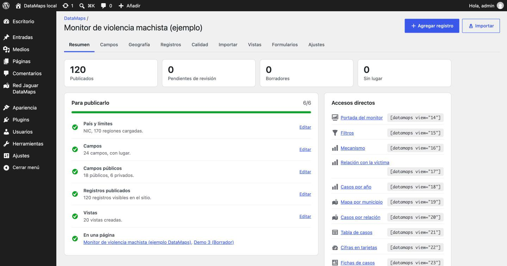

Una base de datos es un monitor: sus campos, sus registros, sus vistas y sus formularios. Un sitio puede tener varias.

## Crear una base

Ve a **Red Jaguar DataMaps → Bases de datos** y llena **Nueva base de datos**:

- **Nombre** y **País.** Cada base cubre un país.
- **Cada registro es un/a:** la palabra para cada registro, en singular y plural, como la muestra el sitio ("28 casos"). Puedes cambiarla después.
- **Empezar con:**
  - **Una base vacía.** Tú agregas los campos, o importas una planilla para crearlos.
  - **Una plantilla**, lista para usar:

    | Monitores | Otros usos |
    |---|---|
    | Monitor de feminicidios | Peñas y clubes de aficionados |
    | Agresiones a la prensa | Obras y promesas públicas |
    | Conflictos socioambientales | Negocios locales |
    | Cortes de internet e incidentes digitales | |

  - **Una estructura exportada de otro sitio:** el archivo `.json` de **Ajustes → Exportar estructura**. Trae campos, ajustes, vistas y formularios, sin registros.

Con una plantilla o una estructura, puedes marcar **Verla funcionando**: agrega 6 registros ficticios de ejemplo, descarga los límites del país y crea una página en borrador con las vistas. Los ejemplos quedan marcados y se borran con un clic en **Registros → Borrar los registros de ejemplo**.

Haz clic en **Crear base de datos**.

## Las pestañas de una base

Siguen el orden del trabajo: configurar, llenar, publicar.

| Pestaña | Para qué sirve |
|---|---|
| **Resumen** | Qué está listo y qué falta para publicarla. |
| **Campos** | Qué guarda cada registro y qué es público. Mira [Campos](/es/datamaps/fields/). |
| **Geografía** | Las regiones del país, para el mapa. Mira [Geografía](/es/datamaps/geography/). |
| **Registros** | Los datos. Mira [Registros](/es/datamaps/records/). |
| **Calidad** | Problemas por corregir. Mira [Calidad](/es/datamaps/quality/). |
| **Importar** | Planillas y Google Sheets. Mira [Importar](/es/datamaps/import/). |
| **Vistas** | Lo que se publica. Mira [Vistas](/es/datamaps/views/). |
| **Formularios** | Formularios públicos. Mira [Formularios](/es/datamaps/forms/). |
| **Ajustes** | Las opciones de abajo. |

**Campos**, **Geografía**, **Vistas**, **Formularios** y **Ajustes** son solo para administradores.

## Ajustes

- **Qué es cada registro:** singular y plural, para las cifras y el mapa.
- **Fecha de cada registro:** el campo que se usa para los años, las líneas de tiempo y el filtro por año.
- **ID único:** las importaciones actualizan el registro con el mismo ID en lugar de duplicarlo.
- **Precisión en el mapa** y **Protección de lugares pequeños:** mira [Privacidad y seguridad](/es/datamaps/privacy-and-security/).
- **Fuente** y **Metodología:** se muestran debajo de las vistas públicas, con la fecha de la última actualización. La metodología es un enlace a la página que explica cómo se recogen y verifican los datos.
- **Datos abiertos:** permite que el público descargue los datos públicos en CSV.
- **Buscadores:** **Describir esta base para Google Dataset Search** agrega una descripción que leen los buscadores, con una **Descripción pública** y una **Licencia de los datos** opcional. Nada privado.
- **Equipo:** quién trabaja en esta base. Mira [Tu equipo](/es/datamaps/team/).
- **Cifrado de los campos privados:** mira [Primeros pasos](/es/datamaps/getting-started/#cifrado-de-los-campos-privados).

Abajo:

- **Datos públicos → Ver el archivo:** el archivo que descargan las páginas públicas. Solo registros publicados y campos públicos.
- **Estructura → Exportar estructura (.json):** para crear el mismo monitor en otro sitio.
- **Borrar base de datos:** borra la base con todos sus campos, registros, vistas y formularios. Expórtala antes. Escribe `BORRAR` para confirmar.
