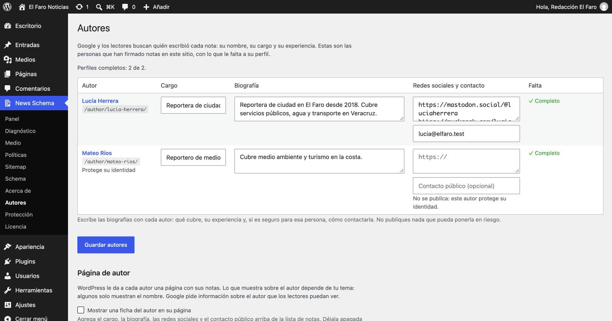

Google y los lectores buscan quién escribió cada nota: su nombre, su cargo y su experiencia. El plugin lo publica en los datos estructurados, a partir del perfil de cada autor.

## El perfil de cada autor

En **Usuarios → Perfil**, la sección **Información del autor para los buscadores** agrega:

| Campo | Qué escribir |
|---|---|
| **Cargo** | Por ejemplo: Reportera de economía. |
| **Redes sociales y perfiles públicos** | Una dirección por línea: redes sociales, sitio personal, Muck Rack. Solo se publica lo que se escribe aquí. |
| **Contacto público** | Opcional. Un correo o un enlace (formulario de contacto, Signal, SecureDrop) donde lectores y fuentes pueden contactar al autor. Mejor que no sea el correo con el que entra al sitio. |
| **Proteger mi identidad** | No se publican los perfiles ni el contacto, y no se muestra imagen de Gravatar. Para periodistas que necesitan limitar lo que se vincula con su nombre. |

La biografía es el campo **Información biográfica** de WordPress. El correo de la cuenta nunca se publica.

## La pantalla Autores

**News Schema → Autores** lista a todas las personas que firmaron notas, con lo que le falta a su perfil. Puedes completar cargos, biografías, redes y contactos de todas a la vez y hacer clic en **Guardar autores**.

:::tip
Escribe las biografías con cada autor: su fuente, su experiencia y, si es seguro para esa persona, cómo contactarla. No publiques lo que la pueda poner en riesgo.
:::

## Direcciones de autor

Por defecto, la dirección de la página de un autor es su nombre de usuario (`/author/ana/`). Eso es la mitad de lo que alguien necesita para adivinar cómo entrar al sitio.

En **Direcciones de autor**, la pantalla lista a los autores cuya dirección muestra su nombre de usuario. Escribe una dirección nueva para cada uno y haz clic en **Cambiar estas direcciones**.

:::caution
Las direcciones anteriores dejan de funcionar a propósito: redirigirlas mostraría qué nombre de usuario corresponde a cada autor. Los enlaces a ellas desde otros sitios mostrarán una página de "no encontrado". Los nombres de usuario no cambian.
:::

## La cuenta de la redacción

Para notas sin firma, o de autores que prefieren no aparecer, usa una cuenta que firme como la redacción. Sus notas se atribuyen a la organización, no a una persona.

- Haz clic en **Crear la cuenta de la redacción**. Nadie puede entrar con ella: recibe un nombre de usuario y una contraseña al azar, y ningún correo.
- O, si una cuenta que ya existe firma con el nombre de tu medio, la pantalla ofrece **Marcarla como cuenta de la redacción**. También puedes marcar **Esta cuenta firma como la redacción, no como una persona** en su perfil.

Elige esta cuenta como autor de la nota en el editor. Explica cuándo lo haces en tu política de **Firmas y seudónimos**.

## Ficha del autor

WordPress le da a cada autor una página con sus notas. Lo que muestra sobre el autor depende de tu tema. Google pide información del autor que los lectores puedan ver.

Activa **Mostrar una ficha del autor en su página** para agregar el cargo, la biografía, las redes y el contacto público arriba de la lista de notas. Déjalo apagado si tu tema ya los muestra: el diagnóstico te lo dice. Las redes y el contacto no se muestran para los autores que protegen su identidad.
