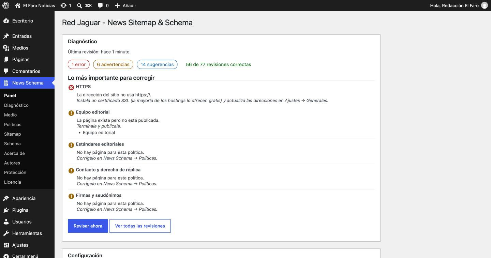

Después de [instalar el plugin y activar la licencia](/es/licenses/install-and-activate/), un aviso arriba del escritorio muestra cuántos pasos de la configuración llevas y cuál sigue. Haz clic en **Continuar la configuración** para ir a él, o sigue estos pasos.

## 1. Llena los datos de tu medio

Abre **News Schema → Medio** y llena por lo menos el nombre de la publicación, el logo, la ciudad y el país. Mira [Medio](/es/news-sitemap-schema/publisher/).

:::tip[¿Ya usas Yoast SEO o Rank Math?]
Si tienen algunos de estos datos, la pantalla te ofrece importarlos a los campos vacíos. No se cambia nada en el otro plugin.
:::

## 2. Corre el diagnóstico

Abre **News Schema → Diagnóstico** y haz clic en **Revisar ahora**. Corrige lo que reporte, empezando por los errores. Cada punto explica cómo. Mira [Diagnóstico](/es/news-sitemap-schema/readiness-check/).

## 3. Asigna tus políticas editoriales

Abre **News Schema → Políticas** y elige la página de tu sitio para cada política que tengas. Mira [Políticas editoriales](/es/news-sitemap-schema/editorial-policies/).

## 4. Completa los perfiles de los autores

Abre **News Schema → Autores** para ver qué le falta al perfil de cada autor y completarlo en un solo lugar. Cada autor también puede hacerlo en **Usuarios → Perfil**. Mira [Autores](/es/news-sitemap-schema/authors/).

## 5. Manda el sitemap de noticias a Google

Abre **News Schema → Sitemap**, copia la dirección de tu sitemap de noticias y envíala en [Google Search Console](https://search.google.com/search-console) → **Sitemaps**. Solo se hace una vez. Mira [Sitemap de noticias](/es/news-sitemap-schema/news-sitemap/).

## Después

El diagnóstico corre solo todos los días. Sus resultados están en el **Panel** del plugin, en un cuadro del escritorio de WordPress y en **Herramientas → Salud del sitio**. Activa las [alertas por correo](/es/news-sitemap-schema/readiness-check/#alertas-por-correo) para enterarte de los errores nuevos sin abrir WordPress.
