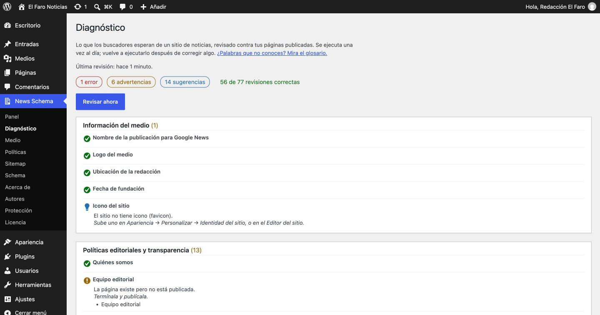

**News Schema → Diagnóstico** hace unas 80 revisiones de lo que los buscadores esperan de un sitio de noticias, sobre las páginas que tu sitio publica de verdad. Corre solo una vez al día. Vuelve a correrlo con **Revisar ahora** después de corregir algo.

## Cómo leer los resultados

Cada revisión es un **error**, una **advertencia** o una **sugerencia**, y cada una explica cómo corregirla, paso a paso. Empieza por los errores.

Las revisiones están agrupadas en secciones:

- Información del medio
- Políticas editoriales y transparencia
- Autores
- Protección de la redacción
- Notas
- Rastreo e indexación
- Datos estructurados
- Sitemap de noticias
- Seguridad y rendimiento
- Revisiones manuales

¿Palabras que no conoces? Mira el [glosario](/es/news-sitemap-schema/glossary/). Todas las revisiones, y dónde se corrige cada una, están en la [referencia de revisiones](/es/news-sitemap-schema/checks/).

## Dónde más ves los resultados

- **News Schema → Panel:** lo más importante para corregir y los pasos de la configuración.
- **El escritorio de WordPress:** un cuadro con el resumen.
- **Herramientas → Salud del sitio:** los errores aparecen junto con las demás revisiones del sitio.

## Copias de prueba

En una copia de prueba (staging, desarrollo) es normal que esté oculta a los buscadores o detrás de una contraseña. El plugin reconoce estas copias y no lo reporta como problema. Vuelve a correr el diagnóstico en el sitio real.

## Revisiones manuales

Algunas cosas no se pueden comprobar desde WordPress, como Google Search Console. La sección **Revisiones manuales** las lista. Revisa cada una y confírmala con **Guardar revisiones manuales**. Cada confirmación vence a los seis meses, para que la vuelvas a revisar.

| Revisión | Qué confirmar |
|---|---|
| Periodismo original y regular | El sitio publica reporteo propio con regularidad, no solo opinión, boletines de prensa o contenido copiado de otros. |
| Sitio verificado en Search Console | La redacción tiene acceso de propietario en Google Search Console, de preferencia como propiedad de dominio, desde una cuenta que pueda usar más de una persona. |
| Sitemap de noticias enviado | El sitemap de noticias está enviado en Search Console → Sitemaps y no muestra errores. |
| Prueba de resultados enriquecidos | Una nota reciente pasa la Prueba de resultados enriquecidos de Google sin errores. |
| Velocidad de carga | La portada y una nota pasan las Core Web Vitals en celular en PageSpeed Insights. |
| Contenido legible sin muros | Las notas se pueden leer sin registrarse, y el aviso de cookies no tapa el texto. |
| Notas republicadas con crédito | Las notas republicadas de otros medios enlazan al original y lo marcan como canónico, o quedan fuera del sitemap de noticias. |
| Seudónimos documentados | Si alguien escribe con seudónimo, la redacción sabe quién es y verificó su identidad, y la política de firmas lo explica. |
| Datos legales decididos | La redacción decidió qué datos legales publica (razón social, registro, dirección), sopesando la transparencia y la seguridad del equipo. |

## Alertas por correo

Abajo de la pantalla, marca **Avisarme por correo cuando aparezca un error nuevo**. Cuando la revisión diaria encuentra un error que no estaba el día anterior, como un sitemap roto o un sitio oculto a Google, manda un correo. Solo errores, una vez cada uno. Las advertencias y sugerencias se quedan en la pantalla.

- **Enviar a:** hasta 5 direcciones separadas por comas. Si lo dejas vacío, se usa el correo de administración de **Ajustes → Generales**.
- **Enviar un correo de prueba** para comprobar que el sitio puede mandar correos. Muchos hostings necesitan un plugin de SMTP para que WordPress mande correos.

Las copias de prueba no mandan alertas. El correo de prueba sí funciona.
