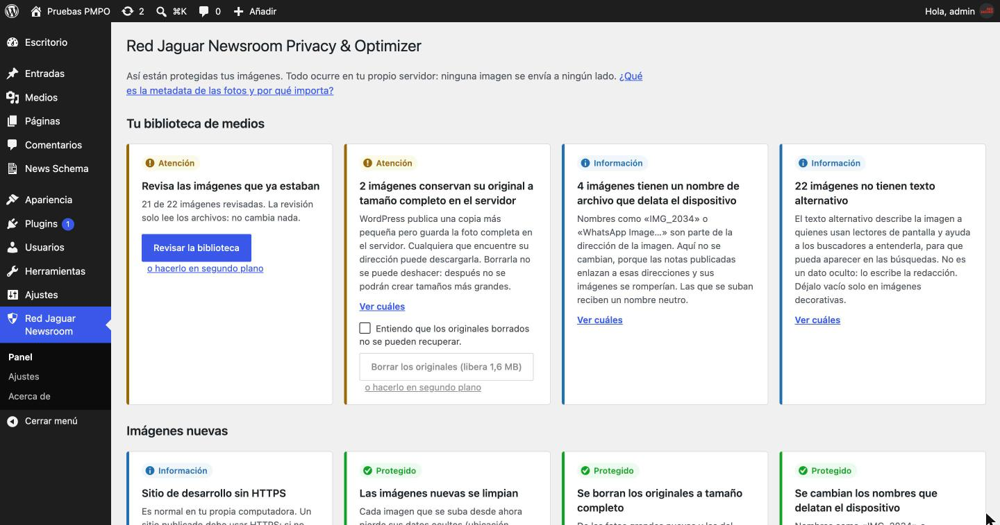

## 1. Instálalo

1. En WordPress, ve a **Plugins → Añadir nuevo plugin**.
2. Busca **Red Jaguar Newsroom Privacy**.
3. Haz clic en **Instalar ahora** y después en **Activar**.

Necesita WordPress 6.5 o posterior y PHP 7.4 o posterior.

## 2. Las imágenes nuevas quedan protegidas

Desde ese momento, cada imagen JPEG, PNG y WebP que subas pierde sus datos ocultos. Los ajustes por defecto son los recomendados; no necesitas cambiar nada. Mira [Imágenes nuevas](/es/newsroom-privacy-optimizer/new-images/).

## 3. Revisa las imágenes que ya estaban

Las imágenes que se subieron antes de activar el plugin **no** se limpian solas.

1. Abre **Red Jaguar Newsroom → Panel**.
2. Haz clic en **Revisar la biblioteca**. La revisión solo lee los archivos: no cambia nada.
3. Mira lo que encontró y límpialo. Mira [Tu biblioteca de medios](/es/newsroom-privacy-optimizer/media-library/).

## 4. Revisa el panel

**Red Jaguar Newsroom → Panel** muestra cómo están protegidas tus imágenes, punto por punto, marcado como **Protegido**, **Atención**, **En riesgo** o **Información**. También te avisa si tu sitio no usa HTTPS: sin él, las fotos viajan sin cifrar desde la computadora de quien reporta hasta tu servidor, con todos sus datos ocultos, antes de que el plugin pueda limpiarlas.

