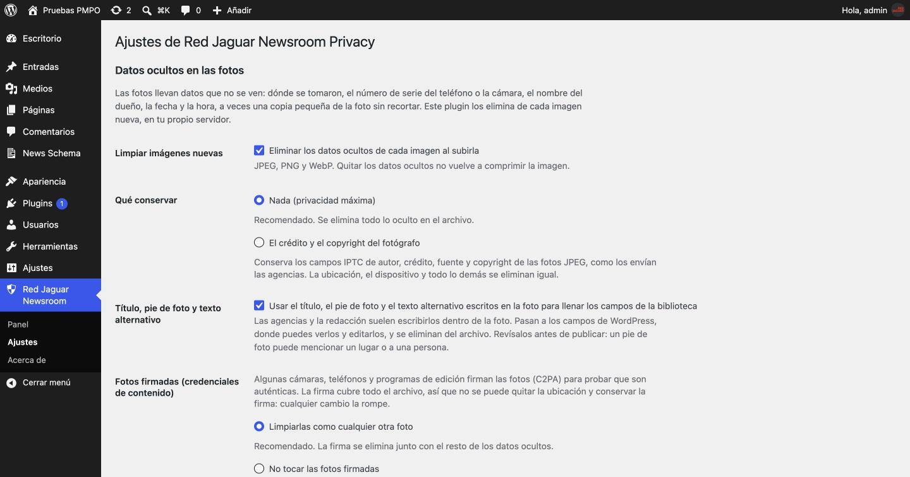

Los ajustes están en **Red Jaguar Newsroom → Ajustes → Datos ocultos en las fotos**.

## Limpiar imágenes nuevas

**Eliminar los datos ocultos de cada imagen al subirla** viene encendido. Quita EXIF (con su miniatura), XMP, IPTC, comentarios y todo lo que vaya pegado después de la imagen, de los archivos JPEG, PNG y WebP, antes de que WordPress genere sus tamaños.

- Quitar los datos ocultos **no vuelve a comprimir la imagen**.
- Las fotos que el teléfono guardó giradas se enderezan primero, para que nunca se vean de lado.
- También se vacían los campos que WordPress copia de la foto a la base de datos (cámara, fecha y otros).

Funciona con el editor de bloques, la biblioteca de medios, la API REST, las imágenes agregadas desde una URL y WP-CLI.

## Qué conservar

- **Nada (privacidad máxima):** recomendado. Se quita todo lo que está oculto en el archivo.
- **El crédito y el copyright del fotógrafo:** conserva los campos IPTC de autor, crédito, fuente y copyright de las fotos JPEG, como los mandan las agencias. La ubicación, el dispositivo y todo lo demás se siguen quitando. Cualquiera que descargue la foto puede leer el nombre del autor.

## Título, pie de foto y texto alternativo

Con **Usar el título, el pie de foto y el texto alternativo escritos en la foto para llenar los campos de la biblioteca**, los textos que las agencias y los editores escriben dentro de las fotos pasan a los campos de WordPress, donde puedes verlos y editarlos, y se quitan del archivo.

:::caution
Revísalos antes de publicar: un pie de foto puede mencionar un lugar o a una persona.
:::

## Fotos firmadas (credenciales de contenido)

Algunas cámaras, teléfonos y programas de edición firman las fotos (C2PA) para probar que son auténticas. La firma cubre todo el archivo, así que no se puede quitar la ubicación y conservar la firma.

- **Limpiarlas como cualquier otra foto:** recomendado. La firma se quita con el resto de los datos ocultos.
- **No tocar las fotos firmadas:** el archivo firmado se queda como está, con su firma válida y todos sus datos ocultos, **incluida la ubicación** si la tiene. Los tamaños que WordPress genera para la página sí se limpian.

## Si una imagen no se puede limpiar

Se recomienda **No subirla**. Un archivo dañado o poco común podría conservar sus datos ocultos; es mejor detenerlo y decir por qué que publicarlo. Si lo apagas, la imagen se sube como está.
