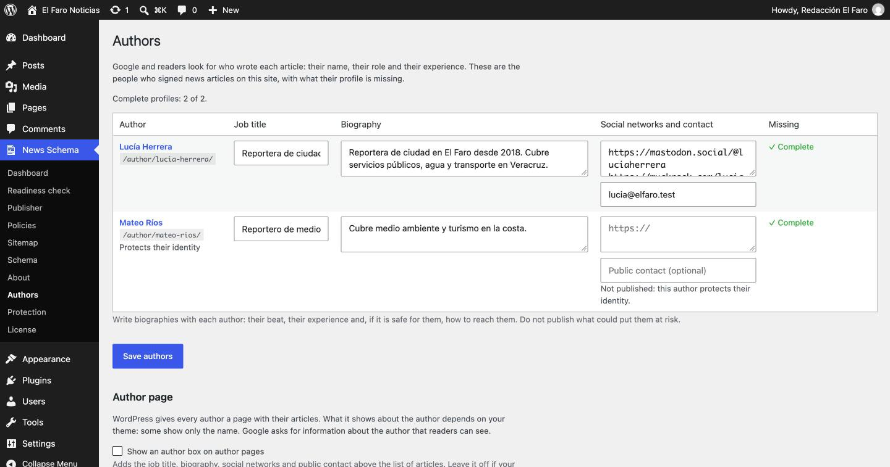

Google and readers look for who wrote each article: their name, their role and their experience. The plugin publishes that in the structured data, from each author's profile.

## Each author's profile

In **Users → Profile**, the section **Author information for search engines** adds:

| Field | What to write |
|---|---|
| **Job title** | For example: Economy reporter. |
| **Social networks and public profiles** | One address per line: social networks, personal site, Muck Rack. Only what is written here is published. |
| **Public contact** | Optional. An email address or a link (contact form, Signal, SecureDrop) where readers and sources can reach the author. Better not the email they log in with. |
| **Protect my identity** | Profiles and contact are not published, and no Gravatar image is shown. For reporters who need to limit what is linked to their name. |

The biography is the usual WordPress **Biographical Info** field. The email of the account is never published.

## The Authors screen

**News Schema → Authors** lists everyone who signed news articles, with what their profile is missing. You can complete job titles, biographies, networks and contacts for all of them at once and click **Save authors**.

:::tip
Write biographies with each author: their beat, their experience and, if it is safe for them, how to reach them. Do not publish what could put them at risk.
:::

## Author addresses

By default, the address of an author page is the login name (`/author/ana/`). That is half of what someone needs to guess their way into the site.

In **Author addresses**, the screen lists the authors whose address shows their login name. Write a new address for each and click **Change these addresses**.

:::caution
The old addresses stop working, on purpose: redirecting them would show which login name belongs to each author. Links to them from other sites will show a "not found" page. Login names do not change.
:::

## The newsroom account

For articles without a byline, or by authors who prefer not to appear, use an account that signs as the newsroom. Its articles are attributed to the organization, not to a person.

- Click **Create the newsroom account**. Nobody can log in with it: it gets a random login name and password, and no email address.
- Or, if an existing account already signs with the name of your outlet, the screen offers **Mark it as a newsroom account**. You can also check **This account signs as the newsroom, not as a person** in its profile.

Choose this account as the author of the article in the editor. Explain when you do it in your **Bylines and pseudonyms** policy.

## Author box

WordPress gives every author a page with their articles. What it shows about the author depends on your theme. Google asks for information about the author that readers can see.

Turn on **Show an author box on author pages** to add the job title, biography, social networks and public contact above the list of articles. Leave it off if your theme already shows them: the readiness check tells you. Networks and contact are not shown for authors who protect their identity.
