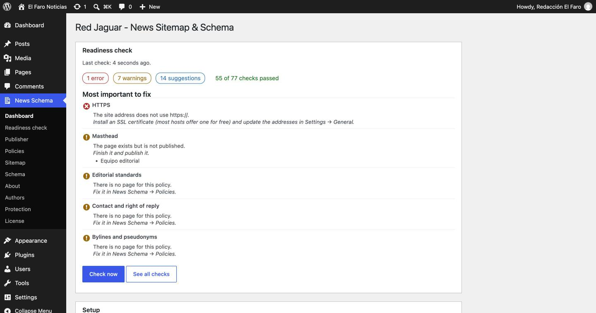

After you [install the plugin and activate the license](/licenses/install-and-activate/), a notice at the top of the dashboard shows how many setup steps are done and which one is next. Click **Continue setup** to go to it, or follow these steps.

## 1. Fill in your newsroom details

Open **News Schema → Publisher** and fill in at least the publication name, the logo, the city and the country. See [Publisher](/news-sitemap-schema/publisher/).

:::tip[Already using Yoast SEO or Rank Math?]
If they have some of these details, the screen offers to import them into the empty fields. Nothing is changed in the other plugin.
:::

## 2. Run the readiness check

Open **News Schema → Readiness check** and click **Check now**. Fix what it reports, starting with the errors. Each item explains how. See [Readiness check](/news-sitemap-schema/readiness-check/).

## 3. Assign your editorial policies

Open **News Schema → Policies** and choose the page of your site for each policy you have. See [Editorial policies](/news-sitemap-schema/editorial-policies/).

## 4. Complete the author profiles

Open **News Schema → Authors** to see what each author's profile is missing and complete it in one place. Each author can also do it in **Users → Profile**. See [Authors](/news-sitemap-schema/authors/).

## 5. Submit the news sitemap to Google

Open **News Schema → Sitemap**, copy the address of your news sitemap and submit it in [Google Search Console](https://search.google.com/search-console) → **Sitemaps**. You only do this once. See [News sitemap](/news-sitemap-schema/news-sitemap/).

## Then

The readiness check runs every day by itself. Its results are on the plugin's **Dashboard**, in a box on the WordPress Dashboard and in **Tools → Site Health**. Turn on [email alerts](/news-sitemap-schema/readiness-check/#email-alerts) to hear about new errors without opening WordPress.
