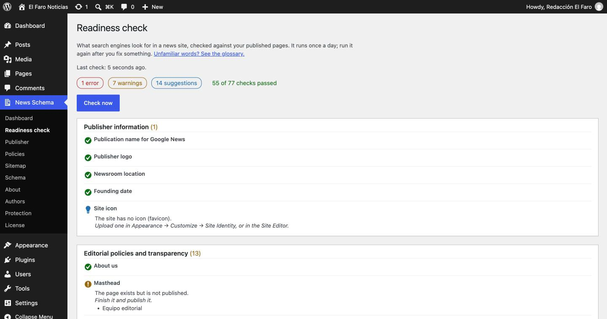

**News Schema → Readiness check** runs about 80 checks of what search engines look for in a news site, against the pages your site really publishes. It runs once a day by itself. Run it again with **Check now** after you fix something.

## Reading the results

Each check is an **error**, a **warning** or a **suggestion**, and each one explains how to fix it, step by step. Start with the errors.

The checks are grouped in sections:

- Publisher information
- Editorial policies and transparency
- Authors
- Newsroom protection
- Articles
- Crawling and indexing
- Structured data
- News sitemap
- Security and performance
- Manual checks

Unfamiliar words? See the [glossary](/news-sitemap-schema/glossary/). Every check, and where to fix it, is in the [check reference](/news-sitemap-schema/checks/).

## Where else you see the results

- **News Schema → Dashboard:** what is most important to fix, and the setup steps.
- **The WordPress Dashboard:** a box with the summary.
- **Tools → Site Health:** the errors appear with the other site checks.

## Test copies

On a test copy (staging, development), being hidden from search engines or behind a password is expected. The plugin recognizes these copies and does not report it as a problem. Run the check again on the live site.

## Manual checks

Some things cannot be verified from WordPress, such as Google Search Console. The **Manual checks** section lists them. Check each one yourself and confirm it with **Save manual checks**. Each confirmation expires after six months, so you review it again.

| Check | What to confirm |
|---|---|
| Original and regular journalism | The site publishes its own reporting regularly, not only opinion, press releases or content copied from others. |
| Site verified in Search Console | The newsroom has owner access in Google Search Console, ideally as a domain property, from an account more than one person can use. |
| News sitemap submitted | The news sitemap is submitted in Search Console → Sitemaps and shows no errors. |
| Rich Results Test | A recent article passes Google's Rich Results Test without errors. |
| Page speed | The home page and an article pass Core Web Vitals on mobile in PageSpeed Insights. |
| Content readable without walls | Articles can be read without registering, and the cookie banner does not hide the text. |
| Republished articles credited | Articles republished from other outlets link to the original and set it as canonical, or are excluded from the news sitemap. |
| Pseudonyms documented | If anyone writes under a pseudonym, the newsroom knows and has verified their identity, and the bylines policy explains it. |
| Legal details decided | The newsroom decided which legal details (company name, registration, address) it publishes, weighing transparency against the safety of the team. |

## Email alerts

At the bottom of the screen, check **Email me when a new error appears**. When the daily check finds an error that was not there the day before, such as a broken sitemap or a site hidden from Google, it sends an email. Only errors, once each. Warnings and suggestions stay on the screen.

- **Send to:** up to 5 addresses separated by commas. Empty: the administration email in **Settings → General**.
- **Send a test email** to make sure the site can send email. Many hosts need an SMTP plugin for WordPress to send email.

Test copies do not send alerts. The test email still works.
