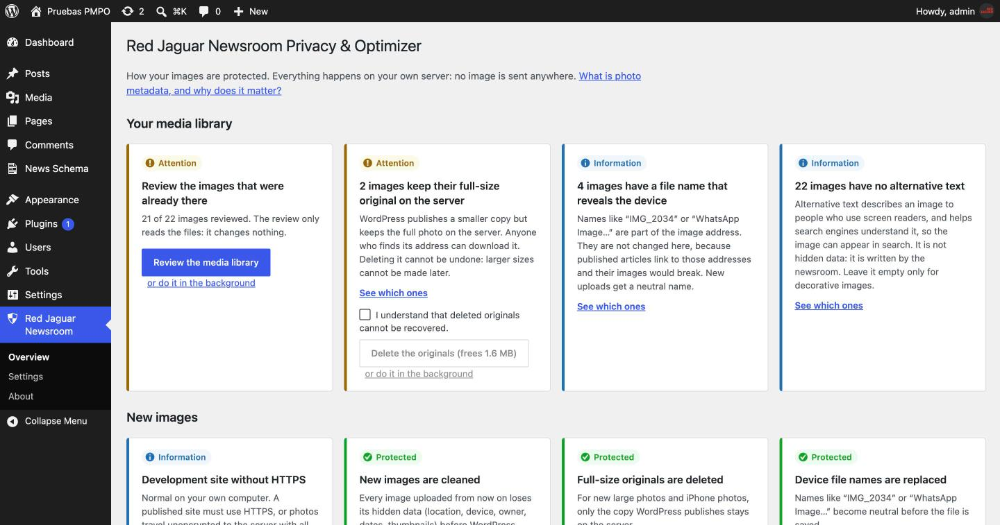

## 1. Install it

1. In WordPress, go to **Plugins → Add New Plugin**.
2. Search for **Red Jaguar Newsroom Privacy**.
3. Click **Install Now**, then **Activate**.

It needs WordPress 6.5 or later and PHP 7.4 or later.

## 2. New images are protected

From now on, every JPEG, PNG and WebP image you upload loses its hidden data. The default settings are the recommended ones; you do not need to change anything. See [New images](/newsroom-privacy-optimizer/new-images/).

## 3. Review the images that were already there

Images uploaded before the plugin was active are **not** cleaned automatically.

1. Open **Red Jaguar Newsroom → Overview**.
2. Click **Review the media library**. The review only reads the files: it changes nothing.
3. Look at what it found and clean it. See [Your media library](/newsroom-privacy-optimizer/media-library/).

## 4. Check the overview

**Red Jaguar Newsroom → Overview** shows how your images are protected, item by item, marked as **Protected**, **Attention**, **At risk** or **Information**. It also warns you if your site does not use HTTPS: without it, photos travel unencrypted from the reporter's computer to your server, with all their hidden data, before the plugin can clean them.

